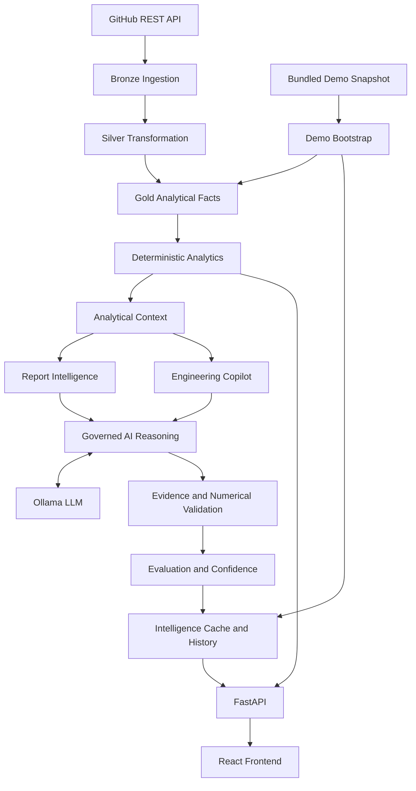

# Engineering Intelligence Platform (EIP)

Evidence-grounded engineering collaboration analytics and AI intelligence.

## Quick Start

```bash
git clone https://github.com/khldsqmr/Engineering-Intelligence-Platform.git
cd Engineering-Intelligence-Platform
docker compose up -d --build --wait
```

Open **http://localhost:8080**.

Only Git and Docker are required. No GitHub token or separately
installed Ollama is needed. Initial startup requires internet access.

See [deployment instructions](#5-quick-start) for requirements and options.

## 1. Overview

The Engineering Intelligence Platform (EIP) transforms GitHub
collaboration data into actionable engineering insights through
deterministic analytics, governed AI reasoning and interactive
data exploration.

EIP is designed to help engineering leaders understand delivery
performance, review effectiveness, collaboration patterns and
potential engineering bottlenecks.

The platform separates analytical computation from AI reasoning.
Metrics are calculated deterministically, while AI-generated
interpretations are grounded in analytical evidence.

Developed as part of the Loop Senior AI/ML Engineer
take-home assignment.

## 2. Platform Capabilities

| Capability | Description |
|---|---|
| Engineering Analytics | Deterministic engineering metrics and reporting-period comparisons |
| AI Insights | Evidence-grounded engineering narratives and hypotheses |
| Engineering Copilot | Conversational exploration of engineering collaboration data |
| Numerical Grounding | Validation of numerical claims against analytical evidence |
| Intelligence Evaluation | Separate evaluation and narrative confidence scores |
| Intelligence History | Persisted execution records and auditability |
| Data Engineering | Bronze, Silver and Gold analytical architecture |
| Deployment | Token-free demo, containerized inference and optional live ingestion |

## 3. Architecture



SQLite provides local persistence for source observations,
standardized records, analytical facts and intelligence history.

Deterministic analytical requests do not require LLM inference.

## 4. Technology Stack

| Layer | Technology |
|---|---|
| Source | GitHub REST API |
| Backend | Python 3.14, FastAPI, Pydantic, HTTPX |
| Data Engineering | Python, SQL, Medallion Architecture |
| Persistence | SQLite |
| AI Inference | Ollama, Qwen 3 |
| Frontend | React, TypeScript, Vite |
| Deployment | Docker Compose, Nginx |
| Testing | Pytest |
| Code Quality | Ruff, Oxlint |

## 5. Quick Start

### 5.1 Recommended: Demo Mode

The default deployment provides a ready-to-use evaluation
environment without GitHub credentials, Python, Node.js
or a separately installed Ollama.

Prerequisites:

- Git
- Docker with Docker Compose v2.24.4 or later
- Internet connectivity for initial image and model downloads
- Recommended: at least 8 GiB of memory allocated to Docker

```bash
git clone https://github.com/khldsqmr/Engineering-Intelligence-Platform.git
cd Engineering-Intelligence-Platform
docker compose up -d --build --wait
```

Open **http://localhost:8080**.

The first startup automatically builds the application,
provisions the local language model, restores the bundled
historical snapshot and starts the application.

No populated .env file is required.

### 5.2 Demonstration dataset

| Attribute | Value |
|---|---|
| Repository | apache/airflow |
| Historical coverage start | September 28, 2026 |
| Coverage end (exclusive) | November 27, 2026 |
| Detailed enrichment start | November 6, 2026 |
| Gold lifecycle records | 4,999 |
| Registered metrics | 14 |
| Materialized period facts | 42 |
| Historical intelligence records | 5 |
| Source coverage | ESTIMATED |

The snapshot is derived from public GitHub data.
Raw Bronze payloads and Silver records are excluded.
Contributor identifiers are consistently pseudonymized.

Public PR identifiers remain available for traceability,
so the dataset should not be considered fully anonymized.

See [demo/manifest.json](demo/manifest.json) for provenance,
coverage, record counts and the snapshot checksum.

Demo Mode uses fixed historical data rather than retrieving
new GitHub observations. Fresh AI intelligence can still
be generated locally.

### 5.3 Suggested evaluation sequence

1. Executive Overview: deterministic engineering metrics.
2. Engineering Lifecycle: collaboration performance.
3. AI Insights: narratives, hypotheses and evidence.
4. Context Explorer: analytical reasoning context.
5. Intelligence History: persisted execution and evaluation.
6. Engineering Copilot: conversational analytical exploration.
7. Data Quality: source coverage and governance.

Cached narratives are immediately available without inference.

Fresh generation may take several minutes on CPU-only hardware.
An observed containerized generation and evaluation request
completed in approximately 176 seconds on the development machine.

### 5.4 Application endpoints

| Service | URL |
|---|---|
| EIP application | http://localhost:8080 |
| Backend API | http://localhost:8001 |
| FastAPI documentation | http://localhost:8001/docs |
| OpenAPI specification | http://localhost:8001/openapi.json |

```bash
curl http://localhost:8001/health
curl http://localhost:8001/api/v1/insights
curl http://localhost:8001/api/v1/ai/narrative
```

### 5.5 Optional: Live Mode

Live Mode supports authenticated ingestion from public GitHub
repositories using the Bronze, Silver and Gold pipelines.

Create the environment configuration:

```bash
cp .env.example .env
```

Create a read-only fine-grained token at:

https://github.com/settings/personal-access-tokens/new

Select public repository access without additional write
permissions or private repository access.

Configure the token and repository in .env:

```dotenv
GITHUB_TOKEN=your_read_only_token
GITHUB_REPOSITORY=apache/airflow
OLLAMA_MODEL=qwen3:4b-instruct
```

Never commit the populated .env file.

Start the isolated deployment:

```bash
docker compose -p eip-live -f compose.yaml -f compose.live.yaml up -d --build --wait
```

Execute the pipelines in dependency order:

```bash
docker compose -p eip-live -f compose.yaml -f compose.live.yaml exec backend python -m backend.pipelines.github_ingestion

docker compose -p eip-live -f compose.yaml -f compose.live.yaml exec backend python -m backend.data_engineering.transformations.silver.github_silver

docker compose -p eip-live -f compose.yaml -f compose.live.yaml exec backend python -m backend.data_engineering.transformations.gold.github_gold
```

Optionally generate historical intelligence:

```bash
docker compose -p eip-live -f compose.yaml -f compose.live.yaml exec backend python -m backend.pipelines.intelligence_bootstrap --periods 3
```

Live application: http://localhost:8082

Live backend: http://localhost:8003

Live Mode uses a separate persistent database volume.
Historical extraction remains bounded by pipeline configuration,
repository activity and GitHub API quota.

### 5.6 Optional: Native Ollama acceleration

Docker Desktop users with a compatible host Ollama installation
may use native inference and hardware acceleration where supported.

Ensure host Ollama is running:

```bash
ollama pull qwen3:4b-instruct
```

Stop the default deployment before switching inference modes:

```bash
docker compose down
```

Start Demo Mode with native inference:

```bash
docker compose -f compose.yaml -f compose.native-ollama.yaml up -d --build --wait
```

The backend accesses Ollama through host.docker.internal.

This optional configuration requires Docker Desktop and
a reachable host inference service.

### 5.7 Persistence and shutdown

Stop the default deployment:

```bash
docker compose down
```

Stop Live Mode:

```bash
docker compose -p eip-live -f compose.yaml -f compose.live.yaml down
```

Named volumes preserve databases, intelligence history
and downloaded models across restarts.

The demo initializer preserves an existing valid database.

Avoid using docker compose down -v unless intentionally
deleting persisted data and model volumes.

## 6. API Reference

### 6.1 Deterministic engineering insights

```bash
curl http://127.0.0.1:8001/api/v1/insights
```

Explicit reporting period:

```bash
curl -G http://127.0.0.1:8001/api/v1/insights \
  --data-urlencode "periodStart=2026-10-01" \
  --data-urlencode "periodEndExclusive=2026-10-08"
```

Reporting periods use UTC boundaries with an exclusive end date.

Select a reporting period supported by the available source data.

### 6.2 Retrieve approved intelligence

```bash
curl http://127.0.0.1:8001/api/v1/ai/narrative
```

Retrieval does not invoke model inference.

### 6.3 Generate engineering intelligence

```bash
curl -X POST \
  http://127.0.0.1:8001/api/v1/ai/narrative \
  -H "Content-Type: application/json" \
  -d '{"periodStart":"2026-10-01","periodEndExclusive":"2026-10-08"}'
```

Generation can reuse previously persisted intelligence when
the applicable context and cache conditions are satisfied.

### 6.4 Engineering Copilot

```bash
curl -X POST \
  http://127.0.0.1:8001/api/v1/ai/copilot \
  -H "Content-Type: application/json" \
  -d '{"question":"How has pull request throughput changed?"}'
```

### 6.5 Additional endpoints

| Method | Endpoint |
|---|---|
| GET | /health |
| GET | /api/v1/ai/context |
| GET | /api/v1/ai/history |
| GET | /api/v1/ai/history/{intelligence_id} |

Complete request and response schemas are available through
the interactive FastAPI documentation.

## 7. Repository Structure

```text
Engineering-Intelligence-Platform/
├── backend/
│   ├── ai_intelligence/
│   ├── analytics/
│   ├── api/
│   ├── core/
│   ├── data_engineering/
│   │   ├── database/
│   │   ├── ingestion/
│   │   ├── sql/
│   │   └── transformations/
│   ├── pipelines/
│   ├── tests/
│   └── main.py
├── frontend/
│   └── src/
├── deployment/
├── docs/
├── exploration/
├── demo/
├── compose.yaml
├── compose.live.yaml
├── compose.native-ollama.yaml
├── pyproject.toml
├── .env.example
├── README.md
└── NOTES.md
```

## 8. Native Local Development

### Backend

Prerequisites: Python 3.14 and Git.

```bash
python3.14 -m venv .venv
source .venv/bin/activate

python -m pip install -e ".[development]"

python -m uvicorn backend.main:app --reload
```

Backend: http://127.0.0.1:8000

API documentation: http://127.0.0.1:8000/docs

The pipeline modules can also be executed directly from
the activated Python environment.

### Frontend

Prerequisites: Node.js 24 and npm.

In a separate terminal:

```bash
cd frontend
npm ci
npm run dev
```

Frontend: http://127.0.0.1:5173

## 9. Testing and Quality Checks

### Backend

```bash
python -m ruff check backend
python -m pytest -q
```

### Frontend

```bash
cd frontend
npm run lint
npm run build
```

### Docker

```bash
docker compose up -d --build --wait
docker compose ps
```

## 10. Security and Data Governance

- Read-only GitHub source access.
- Public repository identity validation.
- Local environment-based credential configuration.
- Bounded source extraction and API quota management.
- Parameterized database operations.
- Local language model inference.
- Numerical and evidence validation.
- Persisted intelligence execution history.
- Localhost-bound application ports.

Credentials, local databases, model artifacts and generated
build outputs are excluded from version control.

EIP is designed as a local evaluation environment and is not
intended to be exposed publicly without additional access
controls and deployment hardening.

## 11. Documentation

- [Engineering Notes and Design Decisions](NOTES.md)
- [Data Dictionary and Source-to-Target Mappings](docs/07_DATA_DICTIONARY.md)
- [Technical Appendix](docs/99_APPENDIX.md)
