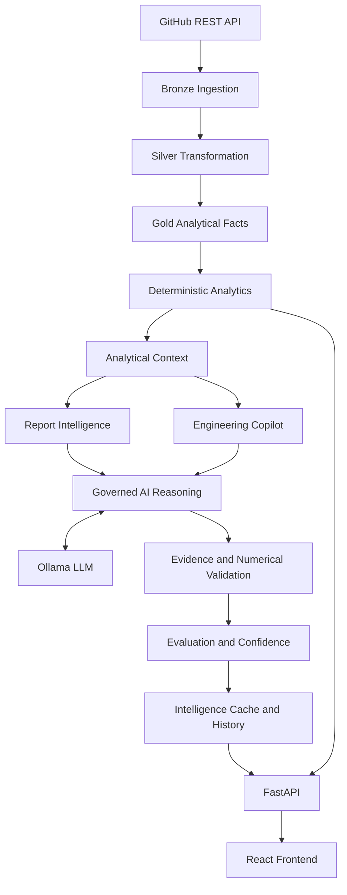

# Engineering Intelligence Platform (EIP)

Evidence-grounded engineering collaboration analytics and AI intelligence.

## 1. Overview

The Engineering Intelligence Platform (EIP) transforms GitHub
collaboration data into actionable engineering insights through
deterministic analytics, governed AI reasoning and interactive
data exploration.

EIP is designed to help engineering leaders understand delivery
performance, review effectiveness, collaboration patterns and
potential engineering bottlenecks.

The platform separates analytical computation from AI reasoning.
Metrics are calculated deterministically, while AI-generated
interpretations are grounded in analytical evidence.

Developed as part of the Loop Senior AI/ML Engineer
take-home assignment.

## 2. Platform Capabilities

| Capability | Description |
|---|---|
| Engineering Analytics | Deterministic engineering metrics and reporting-period comparisons |
| AI Insights | Evidence-grounded engineering narratives and hypotheses |
| Engineering Copilot | Conversational exploration of engineering collaboration data |
| Numerical Grounding | Validation of numerical claims against analytical evidence |
| Intelligence Evaluation | Separate evaluation and narrative confidence scores |
| Intelligence History | Persisted execution records and auditability |
| Data Engineering | Bronze, Silver and Gold analytical architecture |
| Deployment | Containerized backend and frontend |

## 3. Architecture



SQLite provides local persistence for source observations,
standardized records, analytical facts and intelligence history.

Deterministic analytical requests do not require LLM inference.

## 4. Technology Stack

| Layer | Technology |
|---|---|
| Source | GitHub REST API |
| Backend | Python 3.14, FastAPI, Pydantic, HTTPX |
| Data Engineering | Python, SQL, Medallion Architecture |
| Persistence | SQLite |
| AI Inference | Ollama, Qwen 2.5 |
| Frontend | React, TypeScript, Vite |
| Deployment | Docker Compose, Nginx |
| Testing | Pytest |
| Code Quality | Ruff, Oxlint |

## 5. Quickstart

### 5.1 Prerequisites

- Git
- Docker and Docker Compose
- Ollama installed on the host
- GitHub personal access token with read-only access

Ollama is hosted locally and is not provisioned by Docker Compose.

### 5.2 Configure the environment

From the repository root:

```bash
cp .env.example .env
mkdir -p data
```

Update `.env` with a read-only GitHub token.

```dotenv
GITHUB_TOKEN=your_read_only_token
GITHUB_REPOSITORY=apache/airflow
DATABASE_PATH=data/eip.db
OLLAMA_BASE_URL=http://127.0.0.1:11434
OLLAMA_MODEL=qwen2.5:7b
APP_ENV=development
LOG_LEVEL=INFO
```

Never commit the populated `.env` file.

### 5.3 Prepare the local language model

Start Ollama on the host and download the configured model:

```bash
ollama pull qwen2.5:7b
```

Verify that Ollama is available:

```bash
curl http://127.0.0.1:11434/api/tags
```

Docker Compose overrides the backend Ollama URL to access
the host inference service through host.docker.internal.

### 5.4 Start the application

```bash
docker compose up -d --build --wait
```

Verify application health:

```bash
curl http://127.0.0.1:8001/health
```

### 5.5 Populate the analytical database

Execute the data engineering pipeline in dependency order.

Bronze ingestion:

```bash
docker compose exec backend \
  python -m backend.pipelines.github_ingestion
```

Silver transformation:

```bash
docker compose exec backend \
  python -m backend.data_engineering.transformations.silver.github_silver
```

Gold transformation:

```bash
docker compose exec backend \
  python -m backend.data_engineering.transformations.gold.github_gold
```

Bronze ingestion initializes the database automatically.

Historical extraction is bounded by pipeline configuration,
repository activity and GitHub API quota.

The SQLite database is persisted in the local data directory
and remains available across container restarts.

### 5.6 Access the application

| Service | URL |
|---|---|
| EIP Application | http://127.0.0.1:8080 |
| Backend API | http://127.0.0.1:8001 |
| API Documentation | http://127.0.0.1:8001/docs |
| OpenAPI Specification | http://127.0.0.1:8001/openapi.json |

### 5.7 Stop the application

```bash
docker compose down
```

Local analytical data remains persisted in the data directory.

## 6. API Reference

### 6.1 Deterministic engineering insights

```bash
curl http://127.0.0.1:8001/api/v1/insights
```

Explicit reporting period:

```bash
curl -G http://127.0.0.1:8001/api/v1/insights \
  --data-urlencode "periodStart=2026-10-01" \
  --data-urlencode "periodEndExclusive=2026-10-08"
```

Reporting periods use UTC boundaries with an exclusive end date.

Select a reporting period supported by the available source data.

### 6.2 Retrieve approved intelligence

```bash
curl http://127.0.0.1:8001/api/v1/ai/narrative
```

Retrieval does not invoke model inference.

### 6.3 Generate engineering intelligence

```bash
curl -X POST \
  http://127.0.0.1:8001/api/v1/ai/narrative \
  -H "Content-Type: application/json" \
  -d '{"periodStart":"2026-10-01","periodEndExclusive":"2026-10-08"}'
```

Generation can reuse previously persisted intelligence when
the applicable context and cache conditions are satisfied.

### 6.4 Engineering Copilot

```bash
curl -X POST \
  http://127.0.0.1:8001/api/v1/ai/copilot \
  -H "Content-Type: application/json" \
  -d '{"question":"How has pull request throughput changed?"}'
```

### 6.5 Additional endpoints

| Method | Endpoint |
|---|---|
| GET | /health |
| GET | /api/v1/ai/context |
| GET | /api/v1/ai/history |
| GET | /api/v1/ai/history/{intelligence_id} |

Complete request and response schemas are available through
the interactive FastAPI documentation.

## 7. Repository Structure

```text
Engineering-Intelligence-Platform/
├── backend/
│   ├── ai_intelligence/
│   ├── analytics/
│   ├── api/
│   ├── core/
│   ├── data_engineering/
│   │   ├── database/
│   │   ├── ingestion/
│   │   ├── sql/
│   │   └── transformations/
│   ├── pipelines/
│   ├── tests/
│   └── main.py
├── frontend/
│   └── src/
├── deployment/
├── docs/
├── exploration/
├── compose.yaml
├── pyproject.toml
├── .env.example
├── README.md
└── NOTES.md
```

## 8. Native Local Development

### Backend

Prerequisites: Python 3.14 and Git.

```bash
python3.14 -m venv .venv
source .venv/bin/activate

python -m pip install -e ".[development]"

python -m uvicorn backend.main:app --reload
```

Backend: http://127.0.0.1:8000

API documentation: http://127.0.0.1:8000/docs

The pipeline modules can also be executed directly from
the activated Python environment.

### Frontend

Prerequisites: Node.js 24 and npm.

In a separate terminal:

```bash
cd frontend
npm ci
npm run dev
```

Frontend: http://127.0.0.1:5173

## 9. Testing and Quality Checks

### Backend

```bash
python -m ruff check backend
python -m pytest -q
```

### Frontend

```bash
cd frontend
npm run lint
npm run build
```

### Docker

```bash
docker compose up -d --build --wait
docker compose ps
```

## 10. Security and Data Governance

- Read-only GitHub source access.
- Public repository identity validation.
- Local environment-based credential configuration.
- Bounded source extraction and API quota management.
- Parameterized database operations.
- Local language model inference.
- Numerical and evidence validation.
- Persisted intelligence execution history.
- Localhost-bound application ports.

Credentials, local databases, model artifacts and generated
build outputs are excluded from version control.

EIP is designed as a local evaluation environment and is not
intended to be exposed publicly without additional access
controls and deployment hardening.

## 11. Documentation

- [Engineering Notes and Design Decisions](NOTES.md)
- [Data Dictionary and Source-to-Target Mappings](docs/07_DATA_DICTIONARY.md)
- [Technical Appendix](docs/99_APPENDIX.md)
